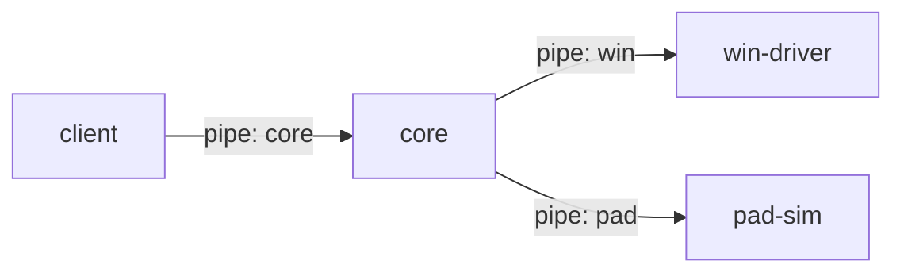

# CUBE SPACE

큐브를 패드에 올려 PC 창을 배치하는 프로그램. 화면(client) · 로컬 서비스(core) · 패드 · Win32 창 제어를 프로세스로 나눴다.

```
apps/
  client/      # Electron 화면 + 트레이. core를 띄우고 붙는다
  core/        # 로컬 서비스: 상태 · 창 배치 계산 · 화면 API
  pad-sim/     # 가상 패드(큐브 4개). 패드 HW 대신
packages/
  protocol/    # 메시지 형식 · pipe · 스냅샷 · 배치 계산(splitRects) · 견본(fixtures)
drivers/
  win-driver/  # C# Win32 창 제어(목록 · 배치 · 열기 · 감시)
```



## 실행

Windows에서 실행한다. node 22 이상, pnpm, .NET 8 SDK가 필요하다.

```
pnpm install
pnpm build:win   # win-driver 빌드 (한 번)
pnpm dev         # core · pad-sim 빌드 후 client 실행
```

- client가 떠 있는 core가 없으면 core를 띄운다. core는 win-driver와 pad-sim을 띄운다.
- 창의 ✕는 숨기기다. 트레이 "종료"를 눌러야 core까지 모두 꺼진다.
- win-driver를 빌드하지 않으면 창 제어 없이 돈다.

## 검사

```
pnpm check       # 모든 패키지의 타입 · lint · 테스트
pnpm check:win   # win-driver가 protocol 견본(fixtures/win)을 읽는지
```

## pad-sim으로 큐브 움직이기

pad-sim을 따로 켜면 stdin으로 조작할 수 있다. core는 `--pad`를 주지 않으면 띄우지 않고 붙기만 한다.

```
node apps/pad-sim/dist/pad-sim.cjs
node apps/core/dist/core.cjs --win drivers/win-driver/bin/Release/net8.0-windows/WinDriver.exe
pnpm --filter @cubespace/client dev   # 떠 있는 core에 붙는다
```

pad-sim 명령:

```
move A2:F0 40 60    # 패드 위 (x, y)에 놓기
lift A2:F0          # 패드에서 들기
press A2:F0 long    # 버튼 (long 빼면 short)
link A2:F0 down     # 연결 끊기 / up
list                # 큐브 상태
```

## pipe 이름

`cubespace-core` · `cubespace-win` · `cubespace-pad` · `cubespace-sim`. 환경 변수 `CUBESPACE_PIPE_TAG`를 주면 이름 뒤에 `-태그`가 붙어서, 테스트나 두 번째 실행이 기존 것과 겹치지 않는다.
