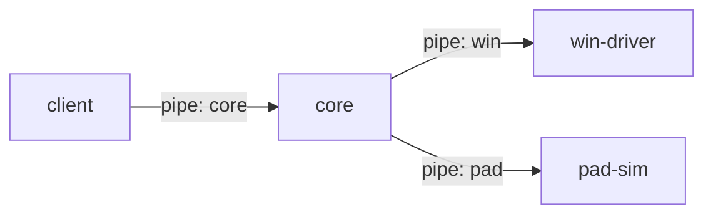

# CUBE SPACE (MVP)

큐브를 패드에 올려 PC 창을 배치하는 프로그램.

## 구조

```
apps/
  client/      # Electron + React 화면 · 트레이
  core/        # 상태를 쥐는 상주 프로그램
  pad-sim/     # 가상 패드(큐브 6개)
packages/
  protocol/    # 프로그램끼리 주고받는 메시지 형식
drivers/
  win-driver/  # C# Win32 창 제어
scripts/       # 팀 공통 git 설정(setup-git · verify-git)
```



## 실행

Windows, node 22+, pnpm, .NET 8 SDK. macOS에서는 win-driver 없이(창 제어 없이) 화면 · core 개발과 테스트만 된다.

```
scripts/setup-git.sh   # git 공통 설정(Windows는 setup-git.ps1, CONTRIBUTING.md 참고)
pnpm install
pnpm build:win   # win-driver 빌드(한 번, Windows만)
pnpm dev
pnpm check       # 포맷 · lint · 타입 · 테스트
```

팀 규칙(설치 · 커밋 · PR)은 `CONTRIBUTING.md`.

## 알아 둘 것

- 창을 닫아도 core는 계속 돈다. 완전히 끄려면 트레이 "종료".
- 실제 패드 대신 가상 패드(pad-sim)로 돈다. 큐브 A–F 6개가 페어링된 상태로 시작한다(임시).
- AI 응답은 가짜라 API 키가 필요 없다.
- `pnpm build:win`을 안 하면 창 목록이 비고 창이 안 움직인다.
